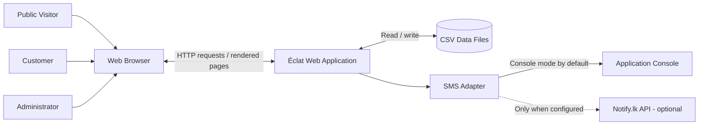
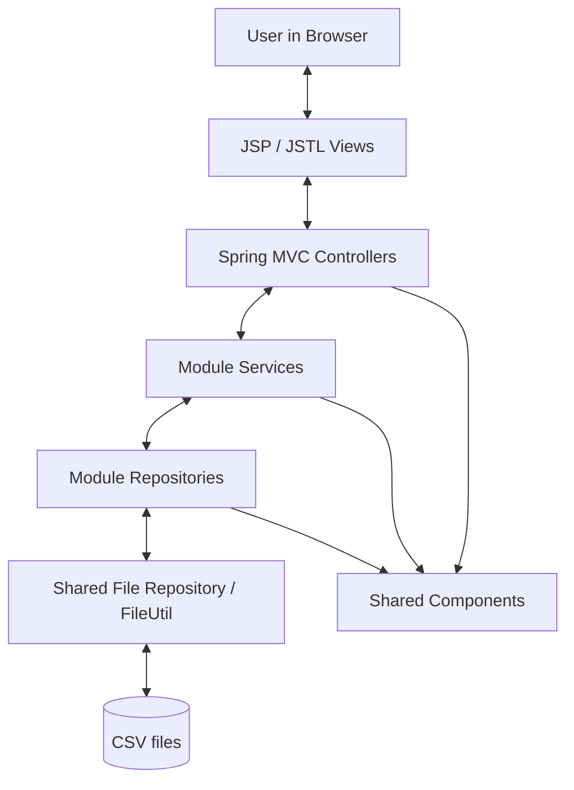
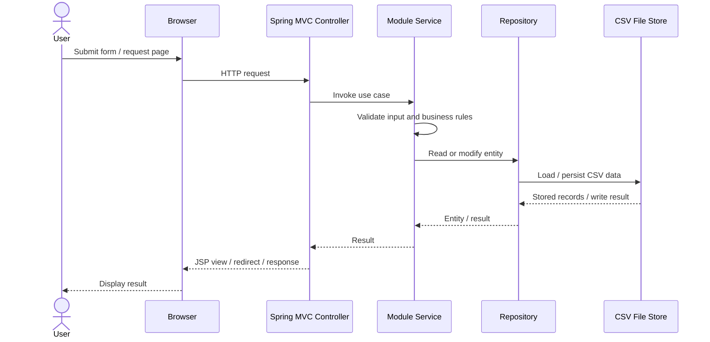
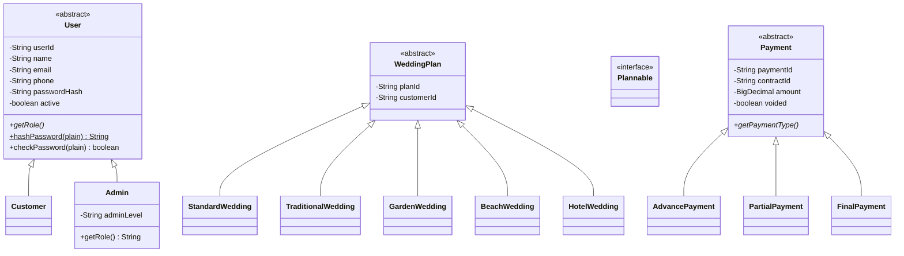
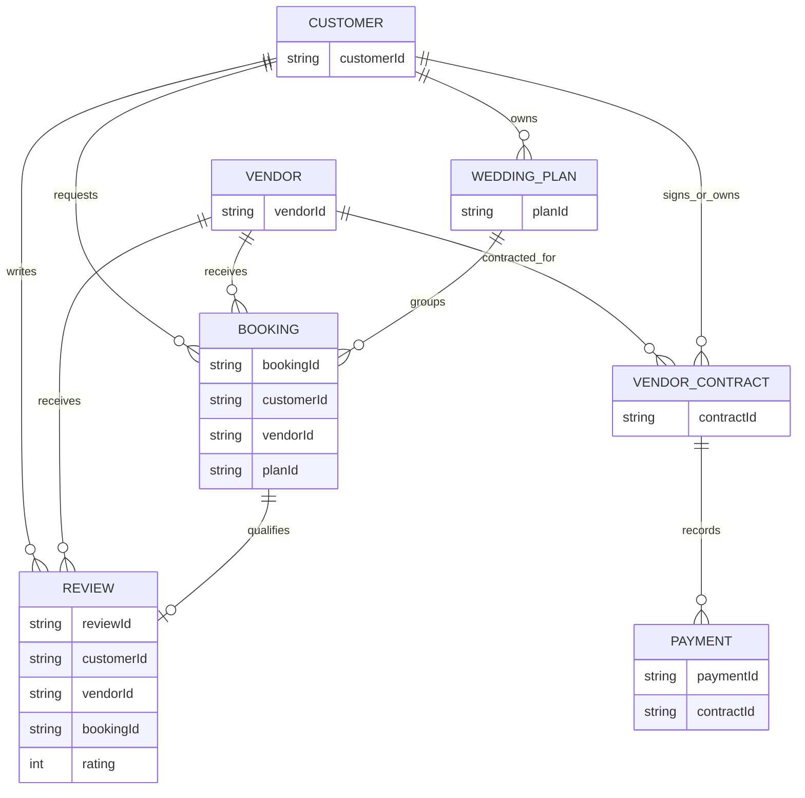
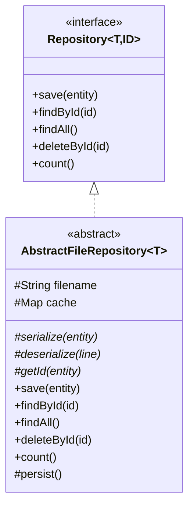

# Éclat — Wedding Planning & Vendor Booking System
## System Documentation

**Course:** SE1020 — Object-Oriented Programming  
**Project:** Wedding Planning and Vendor Booking System  
**Group:** 006 (Six-member integrated application)  
**Document type:** System Documentation  
**Repository:** `it26100877/26-MTR-Y1S2-WD-006-Wedding-Planning-Vendor-Booking-System`  
**Baseline reviewed:** `main` branch, 11 November 2026

---

## Document Control

| Item | Details |
|---|---|
| Document title | Éclat — System Documentation |
| Project name | Wedding Planning and Vendor Booking System |
| Application name | Éclat |
| Course | SE1020 — Object-Oriented Programming |
| Group | 006 |
| Version | 1.0 |
| Status | Project documentation baseline |
| Source of implementation facts | Repository source tree, `README.md`, `pom.xml`, `application.properties`, and `SECURITY_DEPLOYMENT.md` |
| Assessment reference | Updated SE1020 Project Evaluation Marking Guide |

> **Accuracy note:** This document describes the implementation visible in the reviewed `main` branch. Items described as recommendations or future enhancements are not claims that those features already exist. Deployment-specific secrets and live credentials are intentionally excluded.

---

# 1. Executive Summary

Éclat is a Java-based web application developed for the SE1020 Object-Oriented Programming project. It brings together wedding planning and wedding-service vendor booking functions in one integrated application. Customers can create and manage wedding plans, browse vendors, request bookings, track contracts and payments, and submit feedback. Administrators manage customer and vendor-related operations and oversee platform records.

The codebase is organized into six feature modules, supported by shared infrastructure for configuration, user/session models, file persistence, validation, exception handling, and web security. The application uses Spring Boot, Spring MVC, JSP/JSTL views, Maven, and CSV file-backed repositories. The application is packaged as a WAR and can run with the embedded Tomcat configuration or be deployed to a compatible external servlet container.

The design demonstrates object-oriented principles through abstract base classes, inheritance, method overriding, interfaces, generic repositories, and encapsulated domain models. Examples include `User` with `Customer` and `Admin`, `WeddingPlan` with concrete wedding plan types, and `Payment` with advance, partial, and final payment subtypes.

---

# 2. Purpose, Scope and Intended Audience

## 2.1 Purpose

This document explains the system's purpose, architecture, modules, major components, persistence approach, security controls, build/run procedures, and verification approach. It is intended to support development, maintenance, project demonstration, and academic assessment.

## 2.2 Scope

The reviewed project includes the following functional areas:

1. Customer and administrator account management.
2. Wedding plan management, including planning tasks, budget, guests, and timeline-related information.
3. Vendor directory and vendor management.
4. Vendor booking and booking insights/notifications.
5. Vendor contracts and payment tracking.
6. Customer reviews and feedback moderation.

The scope also includes common application infrastructure and the browser-based user interface.

## 2.3 Intended audience

- SE1020 evaluators and academic reviewers.
- Members of Group 006.
- Developers maintaining or extending the project.
- Demonstrators and users who need to run the application locally or in GitHub Codespaces.

## 2.4 Out of scope

This document does not assert that the application integrates a live bank/payment gateway, a production SMS delivery service, a relational database, or a multi-instance distributed deployment. Payment records are application records; the README identifies seeded payment data as fictional demonstration data. Notify.lk integration is configurable and disabled by default.

---

# 3. System Overview

## 3.1 Business problem

Wedding planning requires coordination across budgets, guests, schedules, vendors, bookings, contracts, payments, and post-event feedback. Managing these details independently can cause duplicated records, missed tasks, unclear booking states, and fragmented communication.

Éclat provides a centralized application structure for maintaining these related records and supporting common customer and administrator workflows.

## 3.2 Main actors

| Actor | Main responsibilities |
|---|---|
| Guest / public visitor | View the public homepage and browse publicly available vendor information. |
| Customer | Register or sign in, manage profile and wedding plans, browse vendors, request bookings, view own booking/contract/payment information, and submit eligible reviews. |
| Administrator | Access administrative functions, manage platform records, approve or moderate items, and oversee operations. |
| Application runtime | Validate requests, apply business rules, persist records, manage sessions, and render the user interface. |
| SMS provider adapter | Use console output by default; optionally call Notify.lk when explicitly configured. |

Actual route-level permission rules should be validated against the controllers and security configuration before production deployment.

## 3.3 High-level capability map

| Module | Main capabilities evidenced by source structure |
|---|---|
| Member 01 — Customer & Admin | Registration, login, OTP, profiles, customer/admin services, login rate limiting, SMS adapter. |
| Member 02 — Wedding Planning | Wedding plans, plan types, checklist, budget, guests, summaries and reporting. |
| Member 03 — Vendor Management | Vendor profiles, categories, search/filtering, availability and approval status. |
| Member 04 — Booking Management | Booking lifecycle, booking details, notifications, receipt generation and reports. |
| Member 05 — Contract & Payment | Contracts, payment records, advance/partial/final payment types, reminders and receipts. |
| Member 06 — Reviews & Feedback | Customer reviews, ratings, status and administrator moderation. |

---

# 4. Requirements and Constraints

## 4.1 Functional requirements

The following summarizes the capabilities represented by the repository modules and views.

| ID | Requirement |
|---|---|
| FR-01 | The system shall provide customer registration and authentication views. |
| FR-02 | The system shall support customer and administrator account data management. |
| FR-03 | The system shall support creation and management of wedding plans. |
| FR-04 | The system shall support wedding planning checklist, budget, guest and timeline-related records. |
| FR-05 | The system shall allow vendor information to be stored and searched by relevant criteria. |
| FR-06 | The system shall support booking requests and booking status management. |
| FR-07 | The system shall maintain contract records associated with vendor services. |
| FR-08 | The system shall maintain payment records associated with contracts. |
| FR-09 | The system shall support review submission and review moderation workflows. |
| FR-10 | The system shall persist application records between restarts using the configured CSV file repositories. |
| FR-11 | The system shall render web pages for public, customer, and administrative workflows. |
| FR-12 | The system shall provide common validation, error handling, and web security controls. |

## 4.2 Non-functional requirements

| Area | Requirement / implementation consideration |
|---|---|
| Maintainability | Feature code is separated into packages by module and into controller, model, repository, and service layers where applicable. |
| Portability | Java 17 and Maven Wrapper are used; Codespaces and WAR deployment are documented. |
| Data durability | Repositories persist records to CSV files under the configured data directory. |
| Security | Password hashing, session cookie settings, CSRF protection, security response headers, and login throttling are represented in the code/configuration. |
| Usability | JSP views and shared UI assets provide a browser-based interface. |
| Testability | JUnit/Spring Boot Test dependencies and module-specific tests are present in the repository. |
| Concurrency | A data-directory instance lock prevents multiple application processes from using the same CSV data directory. |
| Scalability constraint | CSV repositories and in-memory caches are intended for a single active application instance per data directory. |

## 4.3 Technical constraints

- Java version: 17.
- Spring Boot version: 3.5.6.
- Build system: Maven Wrapper.
- Packaging: WAR.
- Web framework: Spring MVC.
- Views: JSP and JSTL.
- Embedded servlet runtime: Tomcat (configured as provided for WAR deployment).
- Persistence: CSV files through file-backed repository classes.
- Runtime application port: 8080 by default.

---

# 5. System Architecture

## 5.1 Architectural style

The application follows a modular, layered web-application structure:

- **Presentation layer:** JSP/JSTL pages, CSS, JavaScript, and static image assets.
- **Controller layer:** Spring MVC controllers accept browser requests and coordinate responses.
- **Service layer:** module services implement use-case and business-rule logic.
- **Repository layer:** module repositories expose record operations and use shared file-backed persistence.
- **Domain/model layer:** Java classes represent users, plans, vendors, bookings, contracts, payments, and reviews.
- **Shared infrastructure:** configuration, validation, file utilities, exceptions, security filtering, and data-directory locking.

The six feature modules are grouped under `com.wedding` and share common infrastructure.

## 5.2 Context diagram



## 5.3 Container/component flow



## 5.4 Request processing sequence



## 5.5 Application startup

The `WeddingApplication` class is the Spring Boot entry point. It enables scheduling and extends `SpringBootServletInitializer`, allowing executable WAR use or deployment to an external servlet container. `AppConfig` supplies shared application configuration and components.

---

# 6. Module Specifications

## 6.1 Member 01 — Customer & Admin Management

**Package:** `com.wedding.member01_customer_admin`

### Purpose
Manages application users and the customer/administrator access workflows.

### Principal components
- `CustomerAdminController`
- Models: `Customer`, `Admin`, `OtpChallenge`
- Repositories: `CustomerRepository`, `AdminRepository`
- Services: `CustomerService`, `AdminService`, `OtpService`, `LoginRateLimiter`
- SMS abstractions/adapters: `SmsService`, `ConsoleSmsService`, `NotifyLkSmsService`

### Key responsibilities
- Customer registration and login.
- Customer profile workflows.
- Administrator account and access workflows.
- OTP challenge and verification support.
- Login abuse throttling.
- Optional SMS delivery through a provider abstraction.

### OOP design
`Customer` and `Admin` extend the shared abstract `User` model and implement the role method through overriding. This shares common user state while allowing role-specific behavior and properties.

## 6.2 Member 02 — Wedding Planning

**Package:** `com.wedding.member02_wedding_plan`

### Purpose
Stores and manages a customer's wedding plan and supporting planning information.

### Main model types
- `WeddingPlan`
- `StandardWedding`, `TraditionalWedding`, `GardenWedding`, `BeachWedding`, `HotelWedding`
- `Plannable`
- `WeddingPlanFactory`
- `BudgetItem`, `BudgetCategory`, `BudgetSummary`
- `ChecklistTask`, `RecommendedTask`
- `Guest`, `GuestGroup`, `GuestStats`
- `TimelineEvent`
- Supporting search and summary types.

### Main services and repositories
Services include wedding plan, budget, checklist, guest, admin plan, and reporting services. Dedicated repositories exist for wedding plans, budget items, checklist tasks, guests, and plan items.

### Key responsibilities
- Create and manage wedding plan records.
- Represent different wedding types.
- Maintain budget items and budget summaries.
- Track planning checklist tasks.
- Maintain guest and RSVP-related information.
- Provide planning summaries and report-oriented data.

### OOP design
Concrete wedding types inherit from `WeddingPlan`. The factory class provides a centralized creation mechanism. The `Plannable` interface defines a planning contract for applicable model behavior.

## 6.3 Member 03 — Vendor Management

**Package:** `com.wedding.member03_vendor`

### Purpose
Maintains wedding-service vendor information and supports vendor discovery/administration.

### Principal components
- `VendorController`
- Models: `Vendor`, `VendorCategory`
- Repository: `VendorRepository`
- Service: `VendorService`

### Key responsibilities
- Store vendor profile information such as name, category, contact details, service description and base price.
- Track availability and approval state.
- Search/filter vendor information.
- Support approved-vendor discovery and administrative vendor workflows.

### Domain state represented
The `Vendor` model includes fields for vendor identity, category, contact details, service description, base price, availability, approval status, registration time and active state.

## 6.4 Member 04 — Booking Management

**Package:** `com.wedding.member04_booking`

### Purpose
Manages booking requests connecting customers, vendors and wedding plans.

### Principal components
- Controllers: `BookingController`, `BookingInsightsController`
- Models: `Booking`, `BookingStatus`, `BookingNotification`
- Repositories: `BookingRepository`, `BookingNotificationRepository`
- Services: `BookingService`, `BookingNotificationService`, `BookingPdfReceipt`

### Key responsibilities
- Create and retrieve bookings.
- Link a booking to customer, vendor and plan identifiers.
- Track booking dates, request time, agreed amount, notes and lifecycle status.
- Provide notification and insight/report functionality.
- Generate booking receipt output.

### Relationships
The `Booking` model stores `customerId`, `vendorId` and `planId` references. These are identifier-based links to records owned by the corresponding modules.

## 6.5 Member 05 — Contract & Payment Management

**Package:** `com.wedding.member05_contract_payment`

### Purpose
Maintains vendor contracts and payment records associated with those contracts.

### Principal components
- Controller: `ContractPaymentController`
- Models: `VendorContract`, `ContractStatus`, abstract `Payment`, `AdvancePayment`, `PartialPayment`, `FinalPayment`
- Repositories: `ContractRepository`, `PaymentRepository`
- Services: `ContractService`, `PaymentService`, `OutstandingPaymentReminderScheduler`

### Key responsibilities
- Maintain vendor contract information and status.
- Record payments against contract identifiers.
- Distinguish advance, partial and final payment records.
- Track payment details including amount, method, transaction reference, notes, recording date and void/reversal state.
- Generate payment-related receipts/proof views and schedule outstanding-payment reminders.

### OOP design
`Payment` is an abstract base class. `AdvancePayment`, `PartialPayment`, and `FinalPayment` extend it and supply their own `getPaymentType()` behavior. This demonstrates inheritance, abstraction, and runtime polymorphism.

### Important limitation
Payment records represent records maintained by the application. The reviewed project documentation identifies demonstration payment data as fictional; this documentation does not claim a live payment gateway or real bank settlement integration.

## 6.6 Member 06 — Reviews & Feedback

**Package:** `com.wedding.member06_review_feedback`

### Purpose
Captures customer feedback about vendor services and supports moderation.

### Principal components
- Controller: `ReviewFeedbackController`
- Models: `Review`, `ReviewStatus`
- Repository: `ReviewRepository`
- Service: `ReviewService`

### Key responsibilities
- Submit and retrieve customer reviews.
- Record rating, title, feedback, customer, vendor, and booking references.
- Track review submission/update timestamps and moderation metadata.
- Provide pending-review and moderation workflows.

### Integrity rule represented by the model
A review stores a `bookingId` described in the source as a reference to a verified completed booking. The service layer should enforce this eligibility rule before accepting a review.

---

# 7. Domain Model and Relationships

## 7.1 Key domain entities

| Entity | Description | Key relationship fields |
|---|---|---|
| User | Abstract common account model | User identity and account fields |
| Customer | Customer account | Inherits from `User` |
| Admin | Administrator account | Inherits from `User` |
| WeddingPlan | Base wedding plan model | Customer identifier |
| Vendor | Service provider profile | Category and vendor identity |
| Booking | A request for vendor services | Customer ID, vendor ID, plan ID |
| VendorContract | Contract between parties for a service | Contract identifiers and linked parties |
| Payment | Abstract payment record | Contract ID |
| Review | Customer feedback | Customer ID, vendor ID, booking ID |

## 7.2 Selected inheritance and interface diagram



> The class diagram focuses on inheritance and the abstract payment hierarchy. `Plannable` is shown as an implemented interface in the plan domain; concrete interface implementation should be checked in each class definition when the diagram is refined for code-level detail.

## 7.3 Identifier-based domain links



> This is a conceptual relationship view based on identifier fields and source comments. The application uses CSV repositories, not a relational database schema with enforced SQL foreign keys. Cardinalities should be treated as conceptual unless verified by service-level validation.

---

# 8. Data Management and Persistence

## 8.1 Persistence approach

The system uses CSV file-based repositories. The common `Repository<T, ID>` interface defines generic repository operations. `AbstractFileRepository<T>` provides common behavior, including:
- An in-memory ordered cache.
- Loading repository records from a data file.
- Serialization and deserialization hooks for concrete repositories.
- Save, find-by-ID, find-all, delete-by-ID and count operations.
- Synchronized repository operations.
- Persistence of cached records through `FileUtil`.

Concrete module repositories provide entity-specific serialization, deserialization, and identity behavior.

## 8.2 Repository pattern



## 8.3 File format and data directory

The file utility and configured data directory are responsible for reading and writing data. Each concrete repository owns its file name and conversion between an entity and its stored record representation.

The exact production data-directory path depends on the runtime configuration/environment. Do not assume the repository working directory is the only data location; inspect `FileUtil` and deployment environment values when operating a deployed instance.

## 8.4 Persistence safeguards

The source includes `DataDirectoryInstanceLock`. At startup, the application acquires an exclusive operating-system lock for the configured data directory. This prevents two application processes from concurrently using the same CSV repository directory.

### Operational constraints
- Run only one application instance against a given CSV data directory.
- Back up data files before manual edits, upgrades, or migrations.
- Avoid editing CSV records while the application is running.
- Keep the data directory outside source-controlled files where possible.
- For multiple replicas or transactional workloads, plan a migration to a shared database and shared coordination service.

## 8.5 Conceptual data dictionary

| Data group | Representative stored attributes |
|---|---|
| User/account | ID, name, email, phone, password hash, creation time, active state, role-specific attributes |
| Wedding plan | Plan ID, customer ID, plan attributes/type and related planning metadata |
| Budget | Budget item ID, plan ID, category, description, amount and status-related details |
| Checklist | Task ID, plan ID, task description, completion/due information |
| Guest | Guest ID, plan ID, guest details and RSVP/group information |
| Vendor | Vendor ID, name, category, contact details, base price, availability and approval state |
| Booking | Booking ID, customer ID, vendor ID, plan ID, date, status, agreed amount and notes |
| Contract | Contract ID, customer/vendor references, contract details and status |
| Payment | Payment ID, contract ID, amount, payment date/method, transaction reference, notes and voided flag |
| Review | Review ID, customer/vendor/booking IDs, rating, feedback, dates and moderation metadata |

This is a high-level data dictionary. Concrete repository serializer formats remain authoritative for field order and escaping rules.

---

# 9. Object-Oriented Design and Coding Standards

The Updated SE1020 Project Evaluation Marking Guide allocates **40 marks** to the application of OOP concepts. The following implementation evidence maps the codebase to those concepts.

## 9.1 Encapsulation

Domain model fields are generally private and exposed through getters/setters or explicit domain methods. This limits direct external access to an object's internal state and provides a defined API for reading/updating values.

Examples:
- `User`
- `Vendor`
- `Booking`
- `Review`
- `Payment`

## 9.2 Abstraction

Abstract classes and interfaces define shared contracts while deferring implementation details.

Examples:
- Abstract `User` with abstract `getRole()`.
- Abstract `Payment` with abstract `getPaymentType()`.
- `Repository<T, ID>` interface.
- `AbstractFileRepository<T>` abstract implementation.
- `Plannable` interface in the wedding-plan domain.

## 9.3 Inheritance

Inheritance is used to reuse common fields and behavior and specialize domain types.

Examples:
- `Customer extends User`.
- `Admin extends User`.
- Concrete wedding types extend `WeddingPlan`.
- `AdvancePayment`, `PartialPayment`, and `FinalPayment` extend `Payment`.
- `AbstractFileRepository<T>` implements `Repository<T, String>`.

## 9.4 Polymorphism

Overridden methods provide type-specific behavior through a shared parent reference or contract.

Examples:
- `Customer` and `Admin` provide role-specific `getRole()` behavior.
- Payment subtypes provide distinct `getPaymentType()` values.
- Wedding-plan subtypes specialize the common wedding plan abstraction.

## 9.5 Information hiding

Private fields and the encapsulated repository implementation help hide internal representation. The repository abstraction allows services to use record operations without depending on CSV serialization details.

## 9.6 Coding conventions

The reviewed project uses package names grouped by feature, descriptive class names, Java naming conventions, and separate controller/model/repository/service packages. Continue to apply:
- `UpperCamelCase` for classes/interfaces/enums.
- `lowerCamelCase` for fields and methods.
- `UPPER_SNAKE_CASE` for constants.
- One clear responsibility per class.
- Consistent formatting and meaningful method/variable names.
- No real credentials, API keys, or passwords in source control.

---

# 10. Security and Privacy

The repository's `SECURITY_DEPLOYMENT.md`, `application.properties`, and source files describe the following controls.

## 10.1 Authentication and passwords
- Passwords are stored as salted PBKDF2-HMAC-SHA256 hashes in the current format.
- Password comparison uses constant-time byte comparison for the derived hash.
- A legacy hash verification path exists for compatibility and successful-login upgrade handling.
- Initial administrator creation requires explicit environment configuration; the application does not publish a default administrator password.

## 10.2 OTP and login protection
- OTP challenge expiry is configured to 5 minutes.
- OTP verification allows up to 5 attempts per challenge.
- OTP resend configuration includes a cooldown and resend limit.
- Login throttling is configured for up to 8 submissions per account/client address within a 15-minute window.
- Rate-limit counters are in-memory and reset after restart.

## 10.3 Web request protection
- A security filter adds response security headers.
- State-changing POST requests require a valid CSRF token.
- Session cookies are configured as HttpOnly and SameSite=Lax.
- `ECLAT_COOKIE_SECURE=true` should be set when the application is served over HTTPS in production.
- The current Content Security Policy allows inline scripts/styles due to existing JSP usage; the deployment guide identifies removing that allowance as future hardening after inline code is moved to static assets and/or protected with nonces/hashes.

## 10.4 SMS configuration
- Console SMS is the default provider.
- Notify.lk can be enabled through environment variables and an approved sender ID.
- Real credentials must be stored as deployment secrets/environment variables and never committed to Git.
- Do not send live messages until the provider account and approved sender are configured.

## 10.5 Data privacy guidance
- Demo records are fictional.
- Do not use actual customer data in publicly shared Codespaces ports or demonstration environments.
- Keep port 8080 private during normal development.
- Back up CSV data before updates or migrations.
- Restrict access to production data directories and deployment secrets.

---

# 11. User Interface and Navigation

The application provides JSP views under `src/main/webapp/WEB-INF/jsp/` and static assets under `src/main/resources/static/`.

## 11.1 View groups

| View group | Example pages |
|---|---|
| Common | Header, footer, alerts, dashboard |
| Public | Public homepage |
| Member 01 | Login, registration, OTP, profile, admin dashboard |
| Member 02 | Plans, plan form, summary, budget, checklist, guests, timeline, admin wedding dashboard |
| Member 03 | Vendor directory, vendor detail, vendor form |
| Member 04 | Bookings, booking form/edit, detail, calendar, notifications, reports, receipt |
| Member 05 | Contracts, contract form/edit/print, payment detail, proofs and receipt |
| Member 06 | Reviews, review form and moderation |

## 11.2 Static assets
CSS, JavaScript and image assets are stored in the static resources folder. The visible CSS files include module-specific styles and shared Éclat presentation styles.

---

# 12. Build, Installation and Execution

## 12.1 Prerequisites

- Java Development Kit (JDK) 17.
- Git.
- Internet access for the first Maven dependency resolution.
- GitHub Codespaces, or a local terminal with Java 17.

A local Maven installation is not required when using the repository's Maven Wrapper.

## 12.2 Run using GitHub Codespaces

1. Open the GitHub repository.
2. Select **Code → Codespaces**.
3. Create or open a Codespace based on `main`.
4. Open a terminal.
5. Run:

```bash
./mvnw spring-boot:run
```

6. Wait for Spring Boot to finish startup.
7. Open the **Ports** panel and open or forward port `8080`.
8. Keep the port private for ordinary development and demo work.

## 12.3 Run locally on Windows

From PowerShell in the repository root:

```powershell
.\mvnw.cmd spring-boot:run
```

Then open:

```text
http://localhost:8080
```

## 12.4 Build the WAR

Linux/macOS/Codespaces:

```bash
./mvnw clean package
```

Windows PowerShell:

```powershell
.\mvnw.cmd clean package
```

The generated WAR is placed under `target/`. The project supports executable WAR use and external servlet-container deployment.

## 12.5 Stop the application

Press `Ctrl + C` in the terminal running the Spring Boot process.

## 12.6 Main routes

The README documents these paths:

| Function | Path |
|---|---|
| Public homepage | `/` |
| Login | `/login` |
| Customer/admin dashboard | `/dashboard` |
| Vendor directory | `/vendors` |

Other routes are module-specific and should be confirmed from the controller mappings.

---

# 13. Configuration and Environment Variables

Do not store secrets in `application.properties` or source control. Use environment variables or the deployment platform's secret manager.

| Variable | Purpose |
|---|---|
| `ECLAT_DEMO_DATA_ENABLED` | Enables/disables local demo-data seeding. |
| `ECLAT_BOOTSTRAP_ADMIN_EMAIL` | Email for one-time initial administrator bootstrap. |
| `ECLAT_BOOTSTRAP_ADMIN_PASSWORD` | Initial administrator password; minimum 12 characters per deployment guide. |
| `ECLAT_BOOTSTRAP_ADMIN_NAME` | Initial administrator name. |
| `ECLAT_BOOTSTRAP_ADMIN_PHONE` | Initial administrator phone. |
| `ECLAT_SMS_PROVIDER` | SMS provider selection; defaults to `console`. |
| `NOTIFYLK_USER_ID` | Notify.lk account user ID. |
| `NOTIFYLK_API_KEY` | Notify.lk API key. |
| `NOTIFYLK_SENDER_ID` | Approved Notify.lk sender ID. |
| `ECLAT_COOKIE_SECURE` | Enables the Secure session-cookie flag when HTTPS is active. |

For administrator bootstrap, configure all four bootstrap variables before the first start. Remove the bootstrap secrets after successful account creation.

---

# 14. Testing and Quality Assurance

## 14.1 Existing test assets

The repository contains automated tests for:
- Spring Boot application context/startup.
- Phone validation utility.
- Login rate limiter.
- Notify.lk SMS service behavior.
- Member 02 service behavior.
- Booking PDF receipt generation.
- Outstanding payment reminder scheduler.

The repository also includes test scripts and a UI test script.

## 14.2 Recommended verification workflow

Run the complete Maven test suite:

```bash
./mvnw test
```

Build the deployable artifact:

```bash
./mvnw clean package
```

Where the repository scripts are intended to be used, inspect their contents and run the relevant script in the documented environment:

```bash
./test-all.sh
./test-full.sh
```

A browser/UI test script is also present:

```bash
node ui-test.mjs
```

The precise browser/runtime prerequisites should be checked in the script before running it.

## 14.3 Functional test checklist

| Test ID | Test scenario | Expected result |
|---|---|---|
| QA-01 | Register a new customer with valid details | Customer record is created and available for later login. |
| QA-02 | Attempt login with invalid credentials | Access is rejected without exposing sensitive information. |
| QA-03 | Submit an invalid or expired OTP | Verification is rejected and attempt rules are respected. |
| QA-04 | Create and update a wedding plan | Valid plan data is saved and displayed. |
| QA-05 | Add a budget item | Budget record is persisted and summary reflects the change. |
| QA-06 | Add guest/checklist records | Related records are stored against the selected plan. |
| QA-07 | Search vendors by criteria | Matching vendors are returned according to filters and approval rules. |
| QA-08 | Submit a booking request | Booking is stored with customer, vendor and plan references. |
| QA-09 | Update booking status | Status and relevant timestamps reflect the permitted transition. |
| QA-10 | Create contract and payment records | Contract/payment records are stored and linked using identifiers. |
| QA-11 | Attempt invalid payment reversal/state change | Business rules reject invalid operations and preserve valid records. |
| QA-12 | Submit a review without eligible completed booking | Review eligibility rule rejects the submission. |
| QA-13 | Submit a review for eligible booking | Review is stored with rating and moderation state. |
| QA-14 | POST without CSRF token | Request is rejected with HTTP 403. |
| QA-15 | Start second process against same data directory | Startup is rejected by the instance-lock safeguard. |
| QA-16 | Restart application and retrieve saved data | Previously persisted CSV records remain available. |

> These are test scenarios for verification. Their expected outcomes should be confirmed by executing the application; this document does not claim that every scenario has already passed.

## 14.4 Defect reporting

When reporting a defect, capture:
- Module and page/route.
- User role and test data type (never publish real passwords).
- Steps to reproduce.
- Expected and actual behavior.
- Console/server log excerpt with secrets and personal data redacted.
- Relevant Git commit/branch.

---

# 15. Deployment and Operational Guidance

## 15.1 Single-instance deployment

The current CSV persistence strategy is designed for a single running instance per data directory. The exclusive instance lock is a safety measure. Do not deploy multiple replicas sharing one CSV directory.

## 15.2 Production readiness checklist

- [ ] Use HTTPS.
- [ ] Set `ECLAT_COOKIE_SECURE=true`.
- [ ] Bootstrap the initial administrator with strong secrets and remove bootstrap variables afterward.
- [ ] Confirm no historical default admin account remains.
- [ ] Keep SMS in console mode until credentials and approved sender configuration are verified.
- [ ] Store data files outside the source checkout and restrict file permissions.
- [ ] Set up regular backups and test restoration.
- [ ] Keep demo seeding disabled for production.
- [ ] Keep port 8080 private unless public access is deliberately required.
- [ ] Verify CSRF rejection and successful form submissions.
- [ ] Confirm the instance lock prevents a second process from using the same data directory.
- [ ] Run the full automated test suite after deployment changes.
- [ ] Review CSP and remove inline-script/style allowances as the UI is hardened.

## 15.3 Scaling path

For multi-instance deployment or stronger transaction/concurrency requirements, a future version should consider:
- A shared relational database with schema migrations.
- Transaction management and foreign-key constraints.
- Shared distributed rate-limit storage (for example, Redis).
- Centralized logs and monitoring.
- Managed file/object storage for uploaded assets.
- Automated database backups and tested restore procedures.

These are recommendations, not current implementation claims.

---

# 16. GitHub, Version Control and Team Contribution

The application is maintained in the Group 006 GitHub repository. Git history is important both for collaboration and for the SE1020 assessment, which allocates 5 marks to individual contribution and GitHub commit history.

Recommended team practices:
1. Each member should commit meaningful changes under their own GitHub identity.
2. Use clear, descriptive commit messages (for example, `Add vendor approval validation`).
3. Avoid committing generated build files, secrets, local user data, or IDE-only files.
4. Review changes before merging into the shared branch.
5. Keep module interfaces and shared naming consistent.
6. Record major design decisions and any integration fixes in the repository.

A commit history should be used as evidence of each member's contribution; this document does not assign individual implementation credit.

---

# 17. Assessment Alignment — Updated SE1020 Project Evaluation

The uploaded Updated Marking Guide (page 1) allocates 100 marks across the following criteria. This section maps documentation evidence to each criterion without claiming awarded marks.

| Marking criterion | Allocation | Where supported in this documentation / project evidence |
|---|---:|---|
| Functionality of assigned CRUD operations — minimum two CRUD operations | 10 | Section 6 module responsibilities; verify Create/Read/Update/Delete behavior through Section 14 test checklist and module controllers/services/repositories. |
| Application of OOP concepts: encapsulation, inheritance, polymorphism, abstraction and information hiding | 40 | Section 9 and Section 7.2; source examples include `User`, `Customer`, `Admin`, `WeddingPlan`, concrete plan types, `Payment` and payment subtypes, and repository abstractions. |
| File handling / DB implementation | 10 | Section 8; `Repository`, `AbstractFileRepository`, `FileUtil`, CSV persistence and instance lock. |
| Completeness | 10 | Sections 3, 6, 11 and 14; six integrated functional modules and their corresponding views, repositories and tests. |
| Individual contribution & GitHub commit history | 5 | Section 16; evaluated from the actual commit history for each student. |
| Presentation & communication skills | 10 | Sections 1–6 and 11 provide the system narrative and module summaries for the demonstration. |
| Class diagrams | 5 | Section 7.2 contains a selected class diagram; expand/validate the full model diagram against final source code before submission. |
| Teamwork (peer review) | 5 | Six-module integration and Section 16 collaboration practices; peer-review evidence must be supplied by the team. |
| Coding standards | 5 | Section 9.6 and package/layer organization; confirm by reviewing the final source and formatting consistency. |
| **Total** | **100** | As shown in the marking guide. |

### Assessment evidence to prepare separately
- A short demo script showing at least two CRUD operations for each assigned module, where applicable.
- Screenshots or a live demonstration of core workflows.
- A final class diagram checked against the exact source branch used for submission.
- GitHub commit history filtered by each student's GitHub account.
- Peer-review records and contribution confirmation.
- A test run log or screenshot showing the automated tests executed.

---

# 18. Known Limitations and Future Improvements

Based on the current architecture and repository documentation:

1. **CSV persistence:** suitable for the current project/single-instance design but lacks the transactional and concurrent-write capabilities of a relational database.
2. **In-memory throttling:** login/rate-limit counters reset when the application restarts and are not shared across multiple application instances.
3. **CSP inline allowances:** existing JSP pages require inline script/style allowances; a stricter nonce/hash-based policy is a future hardening item.
4. **SMS is opt-in:** console mode is the default; live delivery depends on valid Notify.lk credentials and sender approval.
5. **Payment gateway:** the application maintains payment records; a live payment processor is not evidenced by the reviewed documentation.
6. **Complete UML coverage:** diagrams in this document are architectural/conceptual and selected code-level views; a complete detailed UML model should be regenerated and checked against all final source classes before final academic submission.

---

# 19. Glossary

| Term | Meaning |
|---|---|
| CRUD | Create, Read, Update and Delete operations. |
| MVC | Model–View–Controller architectural pattern. |
| JSP | JavaServer Pages technology used for server-rendered views. |
| JSTL | JSP Standard Tag Library. |
| CSV | Comma-separated values; the project uses file-backed delimited records. |
| Repository | A component that provides data access operations for domain records. |
| Service | A component that coordinates application use cases and business rules. |
| Controller | A web component that handles incoming HTTP requests. |
| OTP | One-time password used in an account verification workflow. |
| CSRF | Cross-Site Request Forgery. |
| OOP | Object-Oriented Programming. |
| WAR | Web Application Archive. |

---

# 20. References

1. Group 006 GitHub repository: `https://github.com/it26100877/26-MTR-Y1S2-WD-006-Wedding-Planning-Vendor-Booking-System`
2. Repository `README.md`.
3. Repository `pom.xml`.
4. Repository `src/main/resources/application.properties`.
5. Repository `SECURITY_DEPLOYMENT.md`.
6. Repository source packages under `src/main/java/com/wedding/`.
7. Repository JSP views under `src/main/webapp/WEB-INF/jsp/`.
8. **Updated Marking Guide — SE1020 Object Oriented Programming Project Evaluation**, uploaded reference document, page 1.

---

## Appendix A — Repository Structure (Simplified)

```text
src/
├── main/
│   ├── java/com/wedding/
│   │   ├── common/
│   │   │   ├── exceptions/
│   │   │   ├── model/
│   │   │   ├── persistence/
│   │   │   ├── repository/
│   │   │   ├── security/
│   │   │   ├── service/
│   │   │   └── utils/
│   │   ├── member01_customer_admin/
│   │   ├── member02_wedding_plan/
│   │   ├── member03_vendor/
│   │   ├── member04_booking/
│   │   ├── member05_contract_payment/
│   │   ├── member06_review_feedback/
│   │   ├── AppConfig.java
│   │   ├── HomeController.java
│   │   └── WeddingApplication.java
│   ├── resources/
│   │   ├── application.properties
│   │   └── static/
│   └── webapp/WEB-INF/jsp/
├── test/java/com/wedding/
└── ...
```

## Appendix B — Core Startup Commands

```bash
# Start development server
./mvnw spring-boot:run

# Run automated tests
./mvnw test

# Build WAR package
./mvnw clean package
```

## Appendix C — Change Log

| Version | Date | Description |
|---|---|---|
| 1.0 | 11 November 2026 | Initial system documentation prepared from the reviewed repository baseline and Updated SE1020 marking guide. |
